# Assignment 2 — Data Structures: Report

**Topic:** in-memory workload engine with `DynamicArray`, `MyLinkedList` and `MinHeap`.
**Method:** every structure is written from scratch for primitive `int` values, counts its own
physical operations, and is measured on four workloads.

All numbers in this report come from `results/results.csv`, produced by one command
(`mvn -q compile exec:java`) on JDK 21, Windows. The charts live in `results/plots/`.

---

## 1. What is counted, and how it is measured

`daa.metrics.Metrics` is passed to each structure, and every counter tick is one physical
operation performed inside the method that performs it:

| Counter | One tick means |
| --- | --- |
| `steps` | one read of an array cell, or one hop to the next node of a list |
| `moves` | one write of an array cell (element shift, placement, grow-copy), or one link update in a list |
| `comparisons` | one comparison between two stored elements |

Index arithmetic such as `i < size` compares an index with a length, not two elements, and is
therefore not counted. The structures copy elements with explicit loops instead of
`System.arraycopy`, so the grow-copy of `DynamicArray` and `MinHeap` is visible in the numbers.
Reading a node's value field is not a step either: the assignment defines a step as an array
cell read or a node hop, and keeping that definition is what makes the W1/W2 comparison in
section 5 meaningful.

Measurement protocol: one full pass without recording (JIT warm-up), then, per case, one more
warm-up run and five recorded runs; the time is the median of the five, the counters come from
the last recorded run and are reset after the untimed fill phase. Sizes are
n = 100, 1 000, 10 000, 100 000 and all structures are filled with the same data, the values
`0 … n-1` shuffled with `new Random(42)`.

---

## 2. Complexity table

Bounds refer to n = `size()`. Θ is used where the bound is tight, O/Ω where it is not.

### DynamicArray — one `int[]`, capacity doubled when full

| Operation | Best | Average | Worst | Auxiliary space | Justification |
| --- | --- | --- | --- | --- | --- |
| `add(x)` | Θ(1) | Θ(1) amortised | Θ(n) | Θ(1) | one write at the end; a resize copies n elements but only after n appends, so the cost per append averages to a constant |
| `add(i, x)` | Θ(1) | Θ(n) | Θ(n) | Θ(1) | `i = n` appends; otherwise n − i cells shift right |
| `remove(i)` | Θ(1) | Θ(n) | Θ(n) | Θ(1) | `i = n − 1` only decrements the size; otherwise n − 1 − i cells shift left |
| `get(i)` | Θ(1) | Θ(1) | Θ(1) | Θ(1) | index arithmetic plus a single array read |
| `contains(x)` | Θ(1) | Θ(n) | Θ(n) | Θ(1) | a hit can be the first cell; a miss reads every cell |
| whole structure | — | — | — | Θ(n) | one `int[]` of capacity ≤ 2n |

### MyLinkedList — singly linked, `head` and `tail` references

| Operation | Best | Average | Worst | Auxiliary space | Justification |
| --- | --- | --- | --- | --- | --- |
| `add(x)` | Θ(1) | Θ(1) | Θ(1) | Θ(1) | `tail` makes appending two pointer writes |
| `add(i, x)` | Θ(1) | Θ(n) | Θ(n) | Θ(1) | `i = 0` is two link updates; otherwise i hops to the predecessor |
| `remove(i)` | Θ(1) | Θ(n) | Θ(n) | Θ(1) | `i = 0` unlinks the head; otherwise i hops, then one link update |
| `get(i)` | Θ(1) | Θ(n) | Θ(n) | Θ(1) | i hops from the head |
| `contains(x)` | Θ(1) | Θ(n) | Θ(n) | Θ(1) | the same walk, one comparison per node |
| whole structure | — | — | — | Θ(n) | one 24-byte node per element (Bonus A) |

### MinHeap — array-based binary heap, `data[parent] ≤ data[child]`

| Operation | Best | Average | Worst | Auxiliary space | Justification |
| --- | --- | --- | --- | --- | --- |
| `insert(x)` | Θ(1) | Θ(1) | Θ(log n) | Θ(1) | the new value usually stops after one comparison against its parent; a value smaller than the root climbs log₂ n levels |
| `peekMin()` | Θ(1) | Θ(1) | Θ(1) | Θ(1) | the minimum is stored at the root |
| `extractMin()` | Θ(1) | Θ(log n) | Θ(log n) | Θ(1) | the last leaf moves to the root and sifts down at most log₂ n levels; Θ(1) only if it is already ≤ both children |
| `buildHeap(a)` | Θ(n) | Θ(n) | Θ(n) | Θ(1) | Floyd's bottom-up sift-down sums to at most 2n comparisons |
| whole structure | — | — | — | Θ(n) | one `int[]` of capacity ≤ 2n |

The two structures of W1/W2 have deliberately equal asymptotics for `get` only in the best
case; that difference is exactly what section 5 measures.

---

## 3. Loop invariant proofs

### 3.1 `DynamicArray.remove(int index)` — the shift loop

```java
int removed = data[index];
for (int i = index; i < size - 1; i++) {
    data[i] = data[i + 1];      // 1 step for the read, 1 move for the write
}
size--;
return removed;
```

Let `n = size` at entry (n ≥ 1), `k = index` (0 ≤ k ≤ n − 1), and let `A` be the content of the
array at entry: `A[j] = data[j]` for all 0 ≤ j ≤ n − 1.

**Invariant I(i):** before the iteration whose loop variable is `i` (k ≤ i ≤ n − 1),

1. `data[j] = A[j]` for every j with 0 ≤ j < k — the prefix before the hole is untouched;
2. `data[j] = A[j+1]` for every j with k ≤ j < i — the part already passed has been shifted one
   position to the left;
3. `data[j] = A[j]` for every j with i ≤ j ≤ n − 1 — the part not yet passed still holds its
   original value;
4. `n` and the removed value `A[k]` are unchanged.

**Initialization.** Before the first iteration `i = k`. Range 2 is empty, and ranges 1 and 3
together cover 0 ≤ j ≤ n − 1, where both claim `data[j] = A[j]` — true by the definition of `A`.
Clause 4 holds because nothing has been written yet.

**Maintenance.** Assume I(i) holds for some i with i < n − 1, so the guard is true and the body
runs. The body writes `data[i] = data[i+1]`. Because i + 1 ≤ n − 1, clause 3 applies to j = i + 1
and gives `data[i+1] = A[i+1]`; after the assignment `data[i] = A[i+1]`, so clause 2 now also
holds for j = i. The write touches only position i, so clauses 1 and 3 remain true for all other
indices, and clause 4 is unaffected. Therefore I(i+1) holds before the next iteration.

**Termination.** The loop stops with `i = n − 1`. I(n − 1) gives `data[j] = A[j]` for j < k and
`data[j] = A[j+1]` for k ≤ j ≤ n − 2. Together these are exactly the original n − 1 elements
except `A[k]`, each in its original relative order, occupying positions 0 … n − 2. The single
`size--` then exposes precisely those elements, and `removed = A[k]` is the only element that
leaves the structure.

**Conclusion.** The invariant splits the array into a finished part and an untouched part, so no
iteration can drop or reorder an element; at termination it describes exactly "the array without
the element at index k". Initialization, maintenance and termination therefore prove that
`remove(index)` returns the right value and leaves the remaining elements correctly shifted, for
every valid index and every size.

### 3.2 `MinHeap.bubbleDown(int index)` — restoring the heap property

```java
while (true) {
    int left = 2 * index + 1, right = left + 1, smallest = index;
    if (left  < size && data[left]  < data[smallest]) smallest = left;
    if (right < size && data[right] < data[smallest]) smallest = right;
    if (smallest == index) return;
    swap(data[index], data[smallest]);
    index = smallest;
}
```

Call the current position `i` and the tree stored in `data[0 … size-1]`.

**Invariant I(i):** before the iteration with current position i,

1. the multiset of the `size` stored values is the same as at entry;
2. the heap property `data[parent] ≤ data[child]` holds for every edge of the tree that is not
   incident to node i;
3. node i is the only position that may violate the heap property with its children.

**Initialization.** `bubbleDown` is called either from `extractMin`, after the last leaf was
copied into the root, or from `buildHeap` on a node whose children are both roots of valid
sub-heaps. In both cases every edge below node i was already valid, and node i is the only
possible violation, so clauses 2 and 3 hold before the first iteration. No value has been
written yet, so clause 1 holds too.

**Maintenance.** Assume I(i) holds and the loop does not return, so `smallest ≠ i`,
`data[smallest] < data[i]`, and `smallest` is the smaller of i's existing children (each child
comparison is performed against the currently smallest candidate). The body swaps the values at
i and `smallest`, moves the cursor to `i' = smallest`, and leaves every other cell alone:

* clause 1: a swap permutes the elements, so the multiset is unchanged;
* clause 2 for the edges incident to i: the edge (i, i′) now satisfies
  `data[i] = old data[i′] ≤ old data[i] = data[i′]`, and for i's other child c we had
  `old data[i′] ≤ data[c]` at the moment of selection, so `data[i] ≤ data[c]` as well;
  every other edge is either not incident to i or has the same two values as before, hence still
  valid;
* clause 2 for the edges of the subtree of i′ below its children: those edges were already valid
  by clause 2 of I(i) and are untouched;
* clause 3: the only cell whose value changed is i′ (and i, which is now valid), so i′ is the only
  candidate for a violation.

Hence I(i′) holds before the next iteration.

**Termination.** The loop returns when `smallest == i`, that is when i has no child or
`data[i] ≤ data[left]` and `data[i] ≤ data[right]`. By clause 2 every other edge already satisfies
the heap property, and the edges incident to i now satisfy it as well, so the property holds for
the whole tree; if i is a leaf there is no incident edge at all and clause 2 already gives the
result.

**Conclusion.** The invariant pins down where the heap can still be broken (only at the moving
position i) and guarantees that no element is created or lost; each iteration repairs the level it
leaves and pushes the single violation one level down, and since the depth is at most ⌊log₂ n⌋ the
loop runs at most log₂ n times. When it stops, no violation remains anywhere, so `data` is again a
valid min-heap and `extractMin` may safely return the value it removed from the root. This proves
the restore step correct and, with the depth bound, gives the Θ(log n) worst case of `extractMin`.

---

## 4. Workload results

### W1 — random access (10 000 `get(index)` calls)

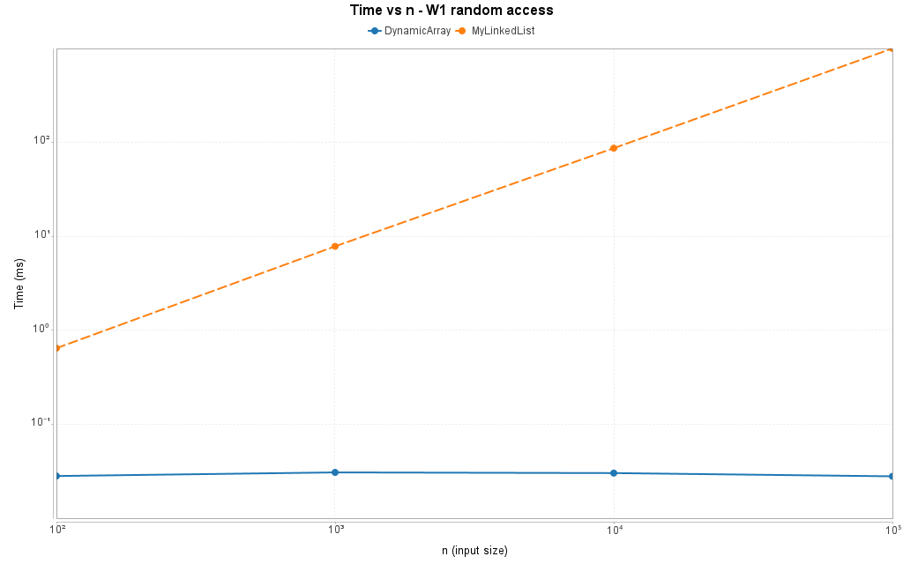
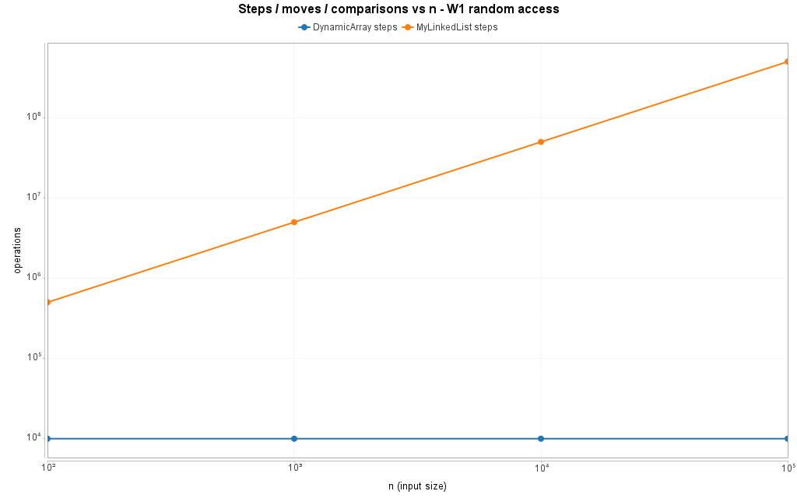

| n | DynamicArray | MyLinkedList | ratio |
| --- | --- | --- | --- |
| 100 | 0.028 ms / 10 000 steps | 0.645 ms / 501 508 steps | 23x |
| 1 000 | 0.031 ms / 10 000 steps | 7.830 ms / 5 005 208 steps | 253x |
| 10 000 | 0.030 ms / 10 000 steps | 86.823 ms / 50 129 208 steps | 2 894x |
| 100 000 | 0.028 ms / 10 000 steps | 999.679 ms / 502 489 208 steps | 35 703x |

The array always costs exactly one step per call, because `get(i)` is an index computation and a
single read. The list costs the distance to the node: on average n/2 hops per call, so
10 000 · n/2 steps — 502 489 208 at n = 100 000, matching the theory within 0.5 %.

### W2 — search (1 000 `contains(x)`, half present, half absent)

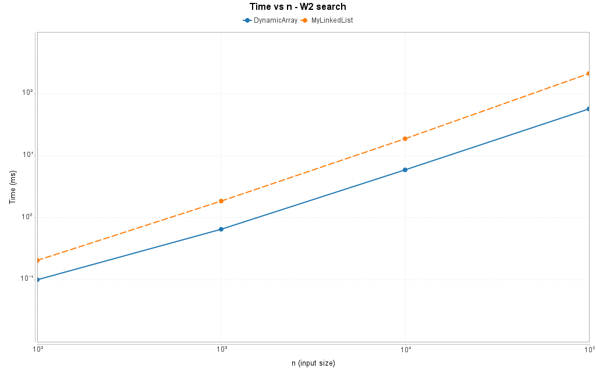
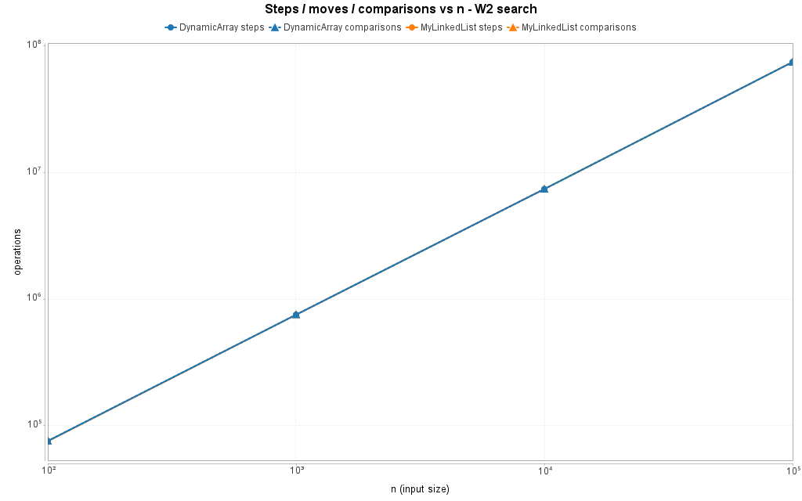

| n | DynamicArray | MyLinkedList | steps (array vs list) |
| --- | --- | --- | --- |
| 100 | 0.100 ms | 0.206 ms | 75 534 vs 75 034 |
| 1 000 | 0.654 ms | 1.865 ms | 751 734 vs 751 234 |
| 10 000 | 5.947 ms | 18.925 ms | 7 403 734 vs 7 403 234 |
| 100 000 | 57.322 ms | 213.658 ms | 74 743 734 vs 74 743 234 |

Both structures perform the same number of comparisons (74 743 734 at n = 100 000) and the same
number of steps, yet the list needs 3.7x the time. The 500-step difference is the only structural
difference: a successful search in the list needs one hop less than the array needs reads, because
the last node is read without hopping again. This chart is the cleanest evidence that equal step
counts do not imply equal running time.

### W3 — insert and remove at the boundaries (1 000 + 1 000 operations)

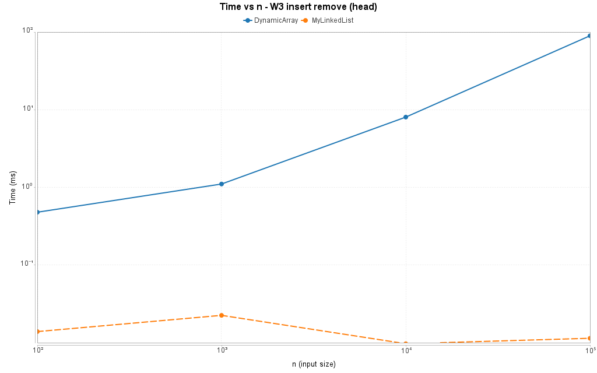
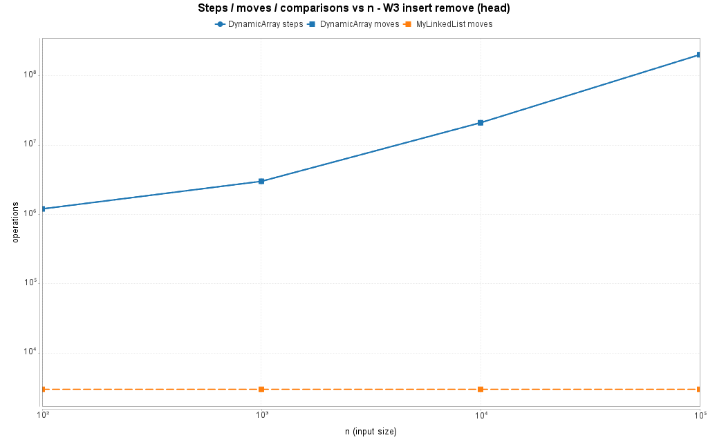
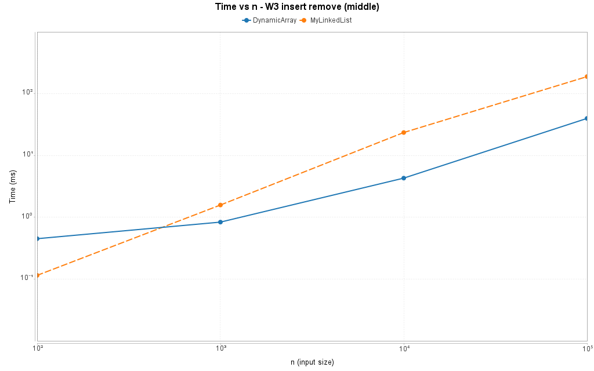
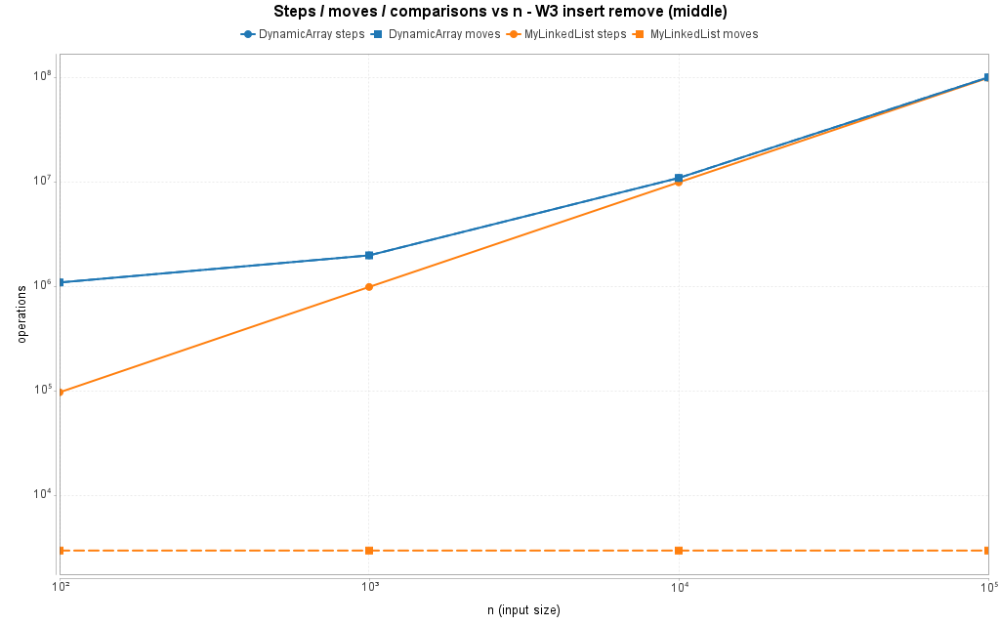

| variant | n | DynamicArray | MyLinkedList |
| --- | --- | --- | --- |
| head | 100 | 0.479 ms / 1 201 120 steps + moves | 0.014 ms / 3 000 moves, 0 steps |
| head | 100 000 | 89.571 ms / 201 000 000 steps + moves | 0.011 ms / 3 000 moves, 0 steps |
| middle | 100 | 0.450 ms / 1 101 120 steps + moves | 0.115 ms / 98 000 steps, 3 000 moves |
| middle | 100 000 | 39.794 ms / 101 000 000 steps + moves | 188.945 ms / 99 998 000 steps, 3 000 moves |

The head variant is where the list is unbeatable: 2 000 operations cost a constant 3 000 link
updates, while the array shifts the whole array on every insert and every removal (89.6 ms at
n = 100 000, roughly 8 000x slower). The middle variant shows the array winning by 4.7x even
though the list performs only 1 % fewer steps, because every array step is a contiguous write
while every list step is a dependent load. Note that for the array `steps` and `moves` are equal:
each shifted element is read once and written once.

### W4 — priority processing (n inserts, then n `extractMin`)

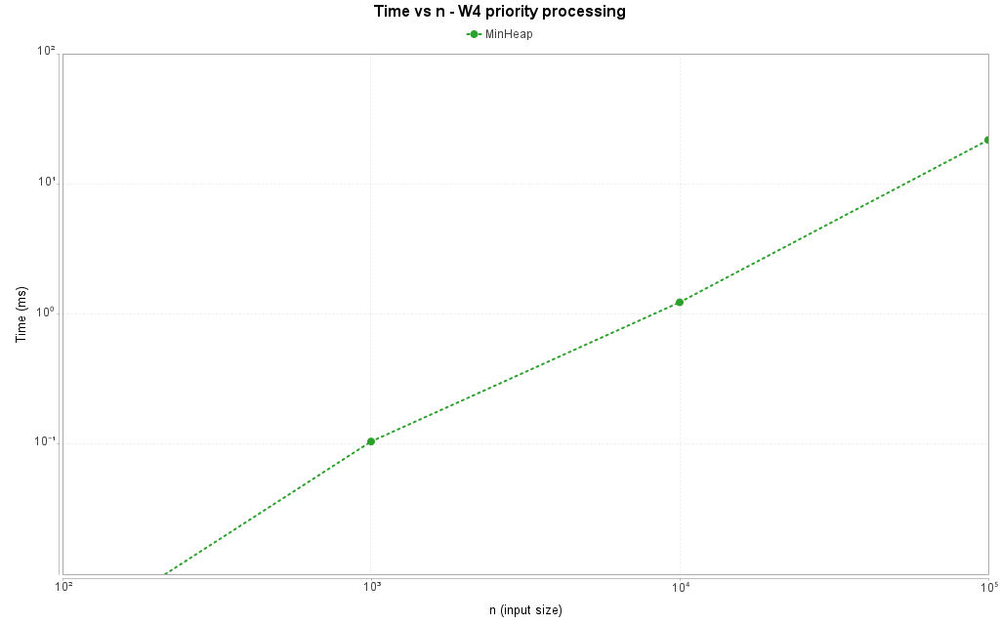
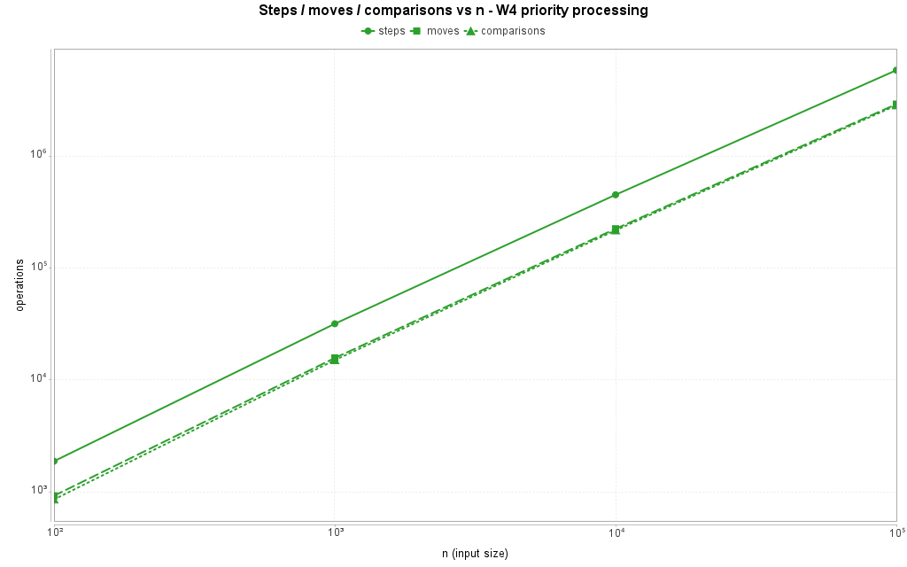

| n | time | steps | moves | comparisons |
| --- | --- | --- | --- | --- |
| 100 | 0.003 ms | 1 878 | 923 | 855 |
| 1 000 | 0.105 ms | 31 713 | 15 695 | 15 018 |
| 10 000 | 1.229 ms | 450 165 | 223 541 | 216 624 |
| 100 000 | 21.727 ms | 5 833 537 | 2 901 807 | 2 831 730 |

The heap is the only structure that never scans: comparisons grow as n log n (2.83 M for
100 000 elements, i.e. ≈ 28 per element) and the extraction order was checked to be
non-decreasing at every size. Almost half of the operations are moves, as every level of a
bubble-up or bubble-down swaps two cells.

---

## 5. Discussion

The measurements make the three questions of the assignment concrete. W1 is the locality
argument in its purest form: the array answers 10 000 `get` calls with exactly 10 000 steps and
0.028 ms at every size, because each step is a 4-byte cell inside a cache line that holds 16
values, so one cache miss pays for fifteen further reads and the prefetcher keeps the sequence in
flight. The list performs the same 10 000 logical lookups but pays 501 508 steps at n = 100 and
502 489 208 steps at n = 100 000, and the time follows the step count from 0.645 ms to 999.679 ms
(35 703x), because a step in the list is a load of the `next` field of a 24-byte node whose address
is only known after the previous load returned — the two loads cannot overlap, so each one costs a
full memory latency instead of a few cycles. W2 isolates the second effect with the step counter
held constant: both structures do 74 743 734 steps and 74 743 734 comparisons at n = 100 000, yet
the list is 3.7x slower (213.658 ms against 57.322 ms), which is exactly the "same Big-O, different
real time" phenomenon the assignment asks about — the array's steps are four bytes apart inside a
few cache lines, the list's steps touch 24 bytes of node each and jump to unrelated heap
addresses. Memory traffic adds to this: Bonus A shows 24.00 bytes per element for the list against
6.55 bytes for the array at the same n, so a scan over the list moves 3.7x more bytes, and since a
64-byte cache line holds 16 array cells but only 2.7 nodes, it also touches about 6x more cache
lines, and a collecting GC that relocates the nodes makes long runs worse. The
ordering also costs the list its head operation: in W3 head the array shifts every element on
each of the 2 000 operations (201 000 000 steps + moves, 89.571 ms at n = 100 000) while the list
performs two or three link updates and finishes in 0.011 ms, an 8 000x gap caused by Θ(n) against
Θ(1) rather than by locality. The middle variant shows the two effects fighting on equal terms:
the list walks n/2 nodes per operation (99 998 000 steps) and the array shifts n/2 cells
(101 000 000 steps), yet the array is 4.7x faster because its steps are contiguous. The heap
rounds the picture off with the smallest constant of the three for its purpose: 2.83 M comparisons
for 100 000 insert/extract pairs (28 per element) because bubble-up and bubble-down follow
`2i+1`, `2i+2` and `(i-1)/2` inside one array and never chase a pointer, and `peekMin` is a single
read. The rule that follows is: use `DynamicArray` whenever access and iteration dominate, use
`MyLinkedList` when the workload touches the ends of a large sequence, when a node handle is
already known, or when stable per-element identity matters more than throughput, and use `MinHeap`
whenever the question is repeatedly "what is the smallest element" instead of "what is at index
i" — it is the only structure of the three that answers that question in O(log n) instead of O(n),
and Bonus B shows how much the same idea is worth one level down: when all elements are known in
advance, `buildHeap` produces the identical heap with 7.3x fewer comparisons than n inserts on
adversarial input. None of this is visible in the asymptotics alone — W3 head is Θ(n) against
Θ(1), but W1 and W2 are Θ(n) on both sides and still differ by up to 35 703x in time, so the
counters plus the cache behaviour, not the Big-O, decide which structure wins.

---

## 6. Bonus A — memory footprint (JOL)

`results/memory.csv` uses `GraphLayout.parseInstance(...).totalSize()`, which walks the whole
object graph, and the chart is `results/plots/memory_vs_n.png`.

| n | DynamicArray | MyLinkedList | MinHeap |
| --- | --- | --- | --- |
| 100 | 720 B (7.20 B/elem) | 2 472 B (24.72 B/elem) | 720 B (7.20 B/elem) |
| 1 000 | 5 200 B (5.20 B/elem) | 24 072 B (24.07 B/elem) | 5 200 B (5.20 B/elem) |
| 10 000 | 41 040 B (4.10 B/elem) | 240 072 B (24.01 B/elem) | 41 040 B (4.10 B/elem) |
| 100 000 | 655 440 B (6.55 B/elem) | 2 400 072 B (24.00 B/elem) | 655 440 B (6.55 B/elem) |

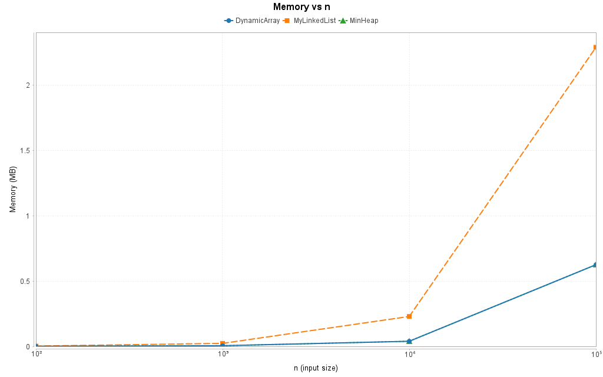

The list costs exactly **24.00 bytes per element**: a 12-byte object header plus a 4-byte `int`
value plus a 4-byte compressed `next` reference is 20 bytes, which the JVM rounds up to the next
8-byte boundary, so 4 bytes of payload carry 20 bytes of overhead and alignment waste (6x). The
array costs 4 bytes per element plus a 16-byte array header, but the reported figure is a step
function of the doubling capacity: at n = 100 000 the capacity has grown to 163 840 cells
(10 · 2¹⁴), so the array occupies 1.64x the payload it stores and the effective cost per element
rises to 6.55 B — 2x waste in the worst case is the price of O(1) amortised appending. `MinHeap`
shows the same profile because it grows with the same policy.

---

## 7. Bonus B — O(n) `buildHeap` against n inserts

`results/buildheap.csv` and four charts in `results/plots/`. Both methods build a heap from the
same array, and both are timed with one warm-up run plus the median of five measured runs.

| order | n | n inserts | `buildHeap` |
| --- | --- | --- | --- |
| random | 10 000 | 0.576 ms, 22 918 comparisons | 0.661 ms, 18 878 comparisons |
| random | 100 000 | 2.683 ms, 227 941 comparisons | 2.531 ms, 187 995 comparisons |
| descending | 10 000 | 0.361 ms, 113 631 comparisons | 0.190 ms, 19 982 comparisons |
| descending | 100 000 | 4.753 ms, 1 468 946 comparisons | 0.918 ms, 199 978 comparisons |

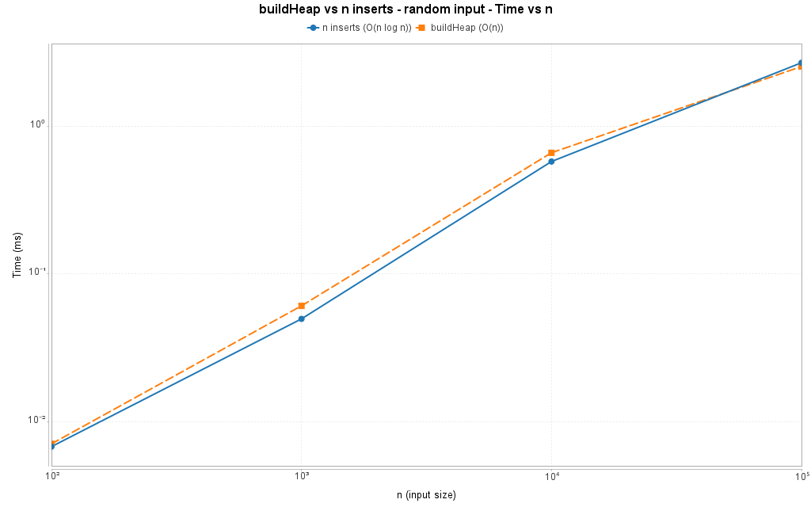
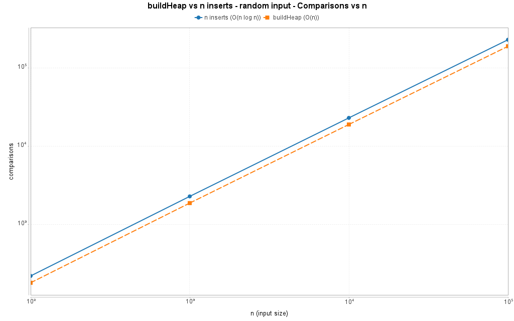
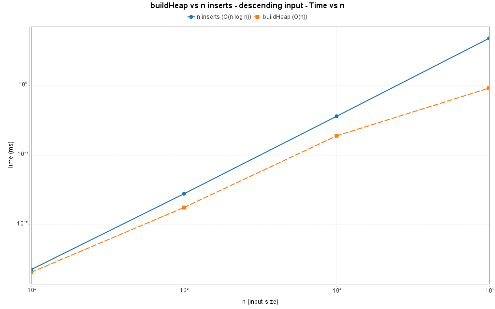
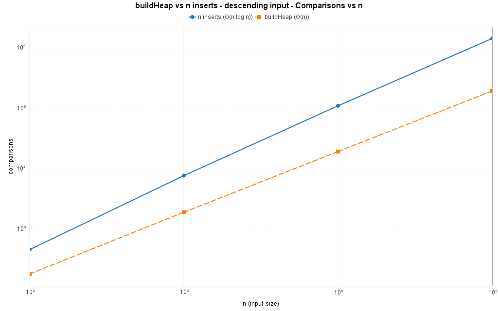

The two input orders tell different stories, and this is the interesting part. On **random** data
the n insertions are *not* Θ(n log n) in practice: a new value stops bubbling after 1.6 levels on
average, so the measured count is only 2.28n comparisons — slightly worse than Floyd's 1.88n
because the sift-down also pays for the comparisons of the second child. The O(n log n) bound is
real, but it is a worst-case bound, and random input never reaches it. On **descending** input it
does: every new value is smaller than all of its predecessors and has to climb to the root, so the
insertions pay 14.7n = 1 468 946 comparisons and 4.753 ms, while Floyd's bottom-up pass stays at
2.0n = 199 978 comparisons and 0.918 ms — 7.3x fewer comparisons and 5.2x less time. The reason is
structural: `buildHeap` sifts down only the `n/2` nodes that have children, and the nodes high in
the tree, which sift farthest, are the fewest, so the total work sums to
Σ depth/2 = Θ(n) — which is why the comparison count is exactly linear in every row of the table
(190, 1 982, 19 982, 199 978). When all elements are known in advance, `buildHeap` is therefore
the right constructor; insert-by-insert is only competitive when a heap has to grow
incrementally, which is also the case the interactive workload W4 measures.

---

## 8. Limitations

* Times are wall-clock medians on one machine and one JVM; they compare the structures with each
  other, not with any absolute baseline. The counters are deterministic and machine-independent.
* `DynamicArray` keeps a 2x growth policy and never shrinks, so the memory chart is a step
  function and the worst-case append is Θ(n) even though its amortised cost is Θ(1).
* `Heap` operations are counted as element comparisons; the index comparisons of the loop
  conditions are excluded by the definition of the counter, which slightly understates the
  internal effort.
